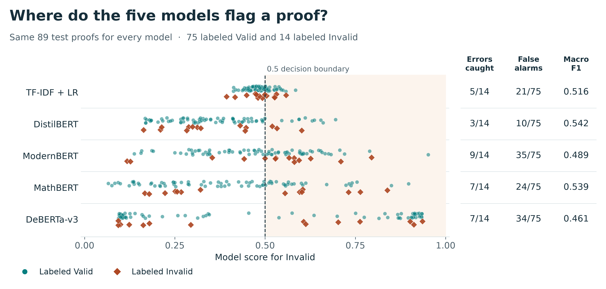

# Detecting Logical Errors in Mathematical Proofs with NLP

**Liam Hu · DSA 495**

Given a theorem and a proposed proof, can a text classifier tell whether the proof establishes the theorem? The project compares character TF-IDF with logistic regression against four fine-tuned BERT encoders on ProofWiki. A second experiment changes a mathematical step and measures whether the model changes its verdict. The implemented prediction task is **Valid / Invalid**. Four error categories describe annotated flaws and edits. Predicting those categories is a possible extension.

## Data and workflow

1. **Clean the source.** Download the ProofWiki portion of NaturalProofs into `Data/` to reproduce cleaning. The script keeps separate proof versions, preserves mathematical notation, and drops empty, reference-only or ambiguous entries. It retained 6,155 of 19,234 theorem–proof pairs. [Download naturalproofs_proofwiki.json](https://zenodo.org/records/4902289/files/naturalproofs_proofwiki.json?download=1) · [Cleaning script](src/clean_proofwiki.py) · [Cleaned data](Data/naturalproofs_proofwiki_clean.json)
2. **Annotate and split.** AI review assigned validity, an explanation and one primary error type where applicable to the first 900 proof versions. Thirteen indeterminate rows were excluded from supervised evaluation and training. Reviews were grouped by theorem and split by file. Training reviews 026–030 contain 122 synthetic flawed replacements. [Original annotations](Data/annotations/) · [Modeling splits](Data/splits/) · [Data and experiment log](docs/log.md)
3. **Train and evaluate.** Select the learning settings on validation Macro F1. Evaluate on the existing test split using Macro F1, Invalid precision and recall, and confusion matrices. Also evaluate the four pretrained encoders with freshly initialized classification heads before any updates. [Notebooks](Notebooks/) · [BERT comparison](Results/model_comparison.csv)
4. **Review and edit proofs.** All five theorem-and-proof models agreed with the existing labels on 25 test proofs. I reviewed those proofs and kept 18. The 16 retained Valid originals each received one main flawed version. Three originals also received symbol edits and valid rewrites. The resulting challenge has 42 distinct versions. [Human review](Results/manually_reviewed_test_proofs.json) · [Edit challenge](Results/proof_edit_challenge.json)
5. **Compare the results.** The poster notebook reads saved scores and labels and exports three figures as PNG and vector PDF. [Poster notebook](Notebooks/07_Poster_Figures.ipynb) · [Exported figures](Results/poster_figures/)

| Labeled proof versions | Train | Validation | Test |
|---|---:|---:|---:|
| Valid | 474 | 74 | 75 |
| Invalid | 235 | 15 | 14 |
| Total | 709 | 89 | 89 |

An Invalid label means the submitted argument fails to establish its theorem. For example, the triangular-number identity is true, but an argument that checks only the base case leaves the general claim unproved. The annotation categories are *Invalid inference*, *Unjustified assumption*, *Missing essential justification*, and *Misapplied theorem / unmet conditions*.

## How to read the results

**Scores and labels.** The figures plot the score for **Invalid**. TF-IDF uses the logistic regression probability for the named class. Each BERT outputs two logits, chooses the larger for its prediction, and applies softmax to report the corresponding scores. An Invalid score above 0.5 gives an Invalid verdict and a score below 0.5 gives Valid. At an exact tie the implementation’s first class wins. The figures use the model’s actual predictions for counts. Scores have not been calibrated as probabilities of mathematical error.

**Review reasons.** Both BERT variants see only the theorem and proof at evaluation. One variant also sees the annotation reason during training. Both reserve the same token space for the proof. MathBERT illustrates the trade-off on the test set. Adding training reasons increased correctly accepted Valid proofs from 51 to 71 out of 75, while correctly detected Invalid proofs fell from 7 to 0 out of 14. The separate TF-IDF reason experiment supplies reasons during evaluation too. [Review-reason comparison](Results/poster_figures/02_review_reasons.png)

**Proof edits.** DeBERTa-v3-base flagged 8 of 16 main flawed edits and TF-IDF flagged 2. All five accepted every one of the nine flawed symbol-edit variants. These originals were deliberately selected because all five models initially accepted them. The test set has only 14 Invalid proofs, and the new edits were AI-authored. These counts describe sensitivity to the selected edits. [Paired score changes](Results/poster_figures/03_proof_edits.png)

## Notebook guide

| Notebook | What it does |
|---|---|
| [01 · TF-IDF baseline](Notebooks/01_Proof_Validity_Baseline.ipynb) | Trains logistic regression on character n-grams and compares inputs with and without a review reason. |
| [02 · DistilBERT](Notebooks/02_DistilBERT.ipynb), [03 · ModernBERT-base](Notebooks/03_ModernBERT_base.ipynb), [04 · MathBERT](Notebooks/04_MathBERT.ipynb), [05 · DeBERTa-v3-base](Notebooks/05_DeBERTa_v3_base.ipynb) | One encoder per notebook. Each compares two fine-tuning inputs and a zero-update control. |
| [06 · Proof edit challenge](Notebooks/06_Proof_Edit_Challenge.ipynb) | Reproduces the five selected theorem-and-proof models, checks their original test results, evaluates the edits and saves the continuous scores. The final cell can be run alone to inspect one edited proof. |
| [07 · Poster figures](Notebooks/07_Poster_Figures.ipynb) | Rebuilds all three poster figures from saved results on CPU. |

## File guide

| Path | Contents |
|---|---|
| `Data/naturalproofs_proofwiki.json` | Raw download linked above. The cleaned JSON has `theorem_id`, `title`, `theorem_text` and `proof_text`. |
| `Data/annotations/proofwiki_review_*.json` | Thirty original review batches. `clean_row_index` identifies a proof version, including when several versions share a theorem ID. |
| `Data/splits/{train,validation,test}/` | The review files supplied to the models. The five training files ending in `_augmented` contain the synthetic edits. |
| [src/proof_experiments.py](src/proof_experiments.py) | Shared split loading, overlap checks, evaluation, confusion matrices and direct prediction for the zero-update controls. |
| `Results/<model>/` | `experiment.json` stores configurations and confusion-matrix counts. `metrics.csv` holds aggregate scores and `predictions.csv` holds one verdict per proof and setting. The PNG files show test confusion matrices. `without_training/` holds the zero-update control. |
| [model_comparison.csv](Results/model_comparison.csv) | Validation and test metrics for the four fine-tuned BERTs, with both training inputs. |
| [all_five_correct_test_without_review_reason.json](Results/all_five_correct_test_without_review_reason.json) | The 25 candidates selected for human review. |
| [manually_reviewed_test_proofs.json](Results/manually_reviewed_test_proofs.json) | The 18 retained after review, including 16 Valid and 2 Invalid. |
| [proof_edit_challenge.json](Results/proof_edit_challenge.json) | The original proofs, edited versions, expected labels, error categories and explanations. |
| [proof_edit_predictions.csv](Results/proof_edit_predictions.csv) | Five predicted labels per challenge version. For example, `390-original` and `390-primary` identify the original and its main flawed edit. |
| [proof_scores.csv](Results/proof_scores.csv) | One Invalid score and native prediction per model and proof version for the 89 test examples and 42 challenge versions. Uses the theorem-and-proof configuration throughout. |
| [poster_figures/](Results/poster_figures/) | Print-ready figures on test scores, review reasons and proof edits. |
| [pyproject.toml](pyproject.toml) and [uv.lock](uv.lock) | Python dependencies and their locked versions. |

## Reproduce locally

From the repository root, run `uv sync --locked` and select the resulting Python environment as the VS Code Jupyter kernel. The notebooks use `Notebooks/` as their working directory. The training notebooks were run with a local CUDA-capable NVIDIA GPU. The first training run downloads the specified pretrained checkpoints.

- **Regenerate the figures** by running notebook 07 with the saved result files.
- **Regenerate the scores and edits evaluation** by running notebook 06. It uses the selected configurations from notebooks 02–05 and the original data splits.
- **Repeat model selection** by running notebooks 01–05 before 06 and 07.
- **Recreate the cleaned corpus** by placing the raw JSON in `Data/` and running `python src/clean_proofwiki.py` from the repository root.

## Attribution and AI use

The corpus is the ProofWiki portion of NaturalProofs by Welleck et al. (2021), derived from ProofWiki contributors’ work. Consult the source dataset’s license and attribution information when redistributing the data. [NaturalProofs dataset and license](https://zenodo.org/records/4902289) · [Paper](https://arxiv.org/abs/2104.01112) · [Source repository](https://github.com/wellecks/naturalproofs)

The project idea and direction are mine. I used AI to help identify and understand the data source, draft documentation, annotate proof versions, generate synthetic errors and implement the experiments. I manually reviewed the 25 selected test proofs and retained 18.
